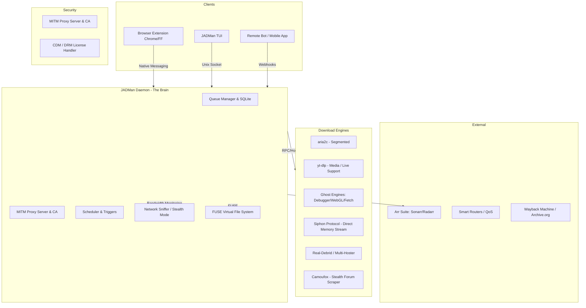

# JADMan (pronounced "Jade-man") — The Ultimate Media Orchestrator

JADMan is a terminal-native, daemon-driven download orchestrator designed for power users and home-server setups. It bridges the gap between manual downloading and fully automated media management.

---

## 🏛️ Updated Architecture

JADMan operates as a central **Rust Daemon** with high-bandwidth bridges to browsers, system TUIs, and external services.

---

## 🚀 Key Capabilities (Current & Planned)

### 1. Hybrid Engine Suite
- **Legacy Engines:** `aria2c` for segments, `yt-dlp` for video/audio.
- **Live Stream Support:** Native handling for Twitch/YouTube livestreams, including `live-from-start` recording.
- **Ghost Engines:** Advanced `DebuggerCapture`, `BrowserFetch`, and `WebGLCapture` (direct Canvas-to-Video recording) for bypassing modern stream encryption.
- **Stealth Mode:** Includes "Human-Mimicry" logic that simulates mouse movements and scrolls to bypass anti-bot detections (e.g., Cloudflare/Google).
- **Siphon Protocol:** A custom binary protocol that allows the browser to stream raw memory chunks (blobs) or recorded Canvas frames directly to the Rust daemon.
- **Stealth Scraper:** Integration with `Camoufox` to bypass anti-bot protections.

### 2. Security & Deep Inspection
- **Transparent Proxy:** Built-in MITM server with custom CA (`rcgen`) and local SOCKS5 proxy on port 6247 to inspect and route traffic.
- **CDM/DRM Support:** Widevine L3 decryption key extractor (`scripts/cdm_extractor.py`) using Frida to hook `libwidevinecdm.so` and dump AES keys.

### 3. Media Automation & "Arr" Integration
- **Mock qBittorrent WebAPI:** Daemon natively serves `/api/v2/*` endpoints on port 6246, allowing Sonarr, Radarr, and Prowlarr to add, track, and delete downloads transparently.
- **Debrid Support:** Resolves Magnet/Torrent links into high-speed HTTP downloads via Lua plugin (`plugins/debrid/realdebrid.lua`).

### 4. Media Streaming & Playback
- **Seekable HTTP Media Streaming:** `GET /stream/:id` serves active and completed downloads with HTTP range headers via `tower_http::services::ServeFile`, enabling instant seekable playback in VLC or mpv before download completes. Pressing `v` in the TUI copies the streaming URL.
- **Virtual File System (VFS) (Future):** FUSE mount exposing active downloads as virtual directories.

### 5. Link Graveyard (Wayback Machine 404 Recovery)
- **Automatic Resurrection:** Automatically detects HTTP 404 failures in `QueueManager` and queries the Wayback Machine API via `plugins/recovery/wayback.lua` to resurrect dead links.

### 6. Smart Bandwidth "Stealth" Mode (Future)
- **Context-Aware Throttling:** Automatically detects low-latency traffic (Gaming, Zoom) and throttles download speeds dynamically.
- **Router Sync:** Communicates with smart routers to balance home-wide internet traffic.

---

## 📂 Project Structure

- `crates/jadm-daemon`: The core brain (RPC, MITM proxy, SOCKS5, HTTP streaming, Arr WebAPI, Engine orchestration).
- `crates/jadm-tui`: The terminal interface (Ratatui, Crossterm, Syntax-highlighted text preview via Syntect).
- `crates/jadm-common`: Shared types and protocol definitions.
- `extension/`: Chrome (MV3) and Firefox (MV2) multi-layered capture extensions with Native Messaging.
- `plugins/`: Extensible Lua plugins (`mlua`) for Real-Debrid, Wayback Machine recovery, Telegram bot, and desktop notifications.
- `scripts/`: Python helper tools for Widevine CDM key extraction (`cdm_extractor.py`) and Camoufox stealth automation (`download_camoufox.py`).
