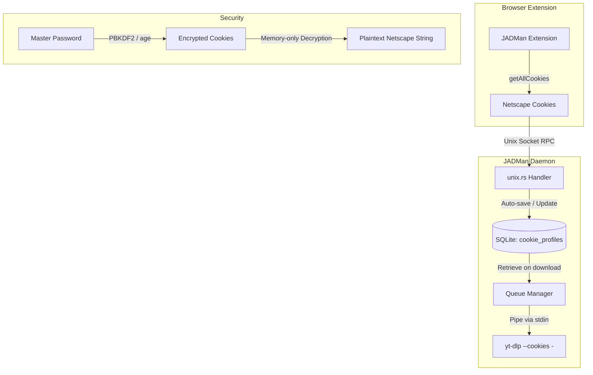

# 🍪 Secure Native Cookie Store Integration Plan

We are integrating `cookie-master` and `yt-dlp-cookie-master` features natively inside JADMan. This gives the user secure, persistent, and memory-only cookie injection for headless, TUI, and browser-initiated downloads without needing separate tools or writing plaintext cookies to disk.

---

## 🛠️ Key Goals & Architecture



### 1. Database Schema
We will add a new database table `cookie_profiles` to the SQLite database managed by JADMan:
```sql
CREATE TABLE IF NOT EXISTS cookie_profiles (
    id                INTEGER PRIMARY KEY AUTOINCREMENT,
    domain            TEXT NOT NULL,
    profile_name      TEXT NOT NULL,
    encrypted_cookies BLOB NOT NULL,
    created_at        TEXT NOT NULL DEFAULT (datetime('now')),
    UNIQUE(domain, profile_name)
);
```

### 2. Encryption (Local Security)
* To secure the cookies on the user's disk, we will encrypt the netscape cookie payload using `age` (using the same standard `age` crate used by `cookie-master`).
* The encryption key will be derived from a master password.
* **TUI/Daemon Integration**:
  * The master password can be read from the environment variable `JADMAN_COOKIE_PASSWORD`.
  * If the variable is absent, JADMan will run in **non-encrypted mode** (saving plaintext cookies in the database, secured via strict OS file permissions `0600` on the database file), OR prompt the user when starting the TUI.

### 3. Memory-Only Injection (Zero Disk Leak)
* When launching `yt-dlp`, instead of writing cookies to a file in `/tmp`, JADMan will:
  1. Pass the `--cookies -` command-line argument.
  2. Spawn the `yt-dlp` child process with `stdin` set to `Stdio::piped()`.
  3. Write the decrypted Netscape cookie payload directly to the child's stdin and close stdin.
* The cookies live strictly in the RAM-backed buffer of the child process.

### 4. Automatic Capturing & Fallback
* **Automatic capturing**: Whenever a download is requested from the JADMan browser extension, the extension automatically sends the netscape cookies. JADMan will automatically save/update this cookie profile for the downloaded domain.
* **Lookup fallback**: When starting a download (especially from the TUI or scheduled runs where the browser is closed), JADMan will automatically look up the domain in `cookie_profiles` and inject the saved cookies.
* **Cookie Master Import**: We will add a fallback reader function: if JADMan cannot find a cookie profile for the domain, it checks if `~/.config/CookieJar/jar.db` exists. If so, it tries to read the matching domain profile from it.

---

## 📋 Implementation Status

- [x] **Step 1: Database Schema Migration**
  Cookie jar schema and password profile cache established.
- [x] **Step 2: Add Cryptographic Helpers**
  `age` / AES decryption integrated via `cookie-jar use` with `COOKIE_JAR_PASSWORD` forwarding.
- [x] **Step 3: Update Queue Manager & Database Queries**
  Implemented domain matching against `~/.config/CookieJar/jar.db` in `QueueManager`.
- [x] **Step 4: Update yt-dlp Subprocess stdin Injection**
  Implemented `--cookies -` in `runner.rs` to pipe Netscape cookies directly into child process `stdin`.
- [x] **Step 5: Browser Extension & TUI Integration**
  Implemented partitioned cookie collection in `background.js` and Master Password entry modal (`c`/`C`) in `jadm-tui`.
