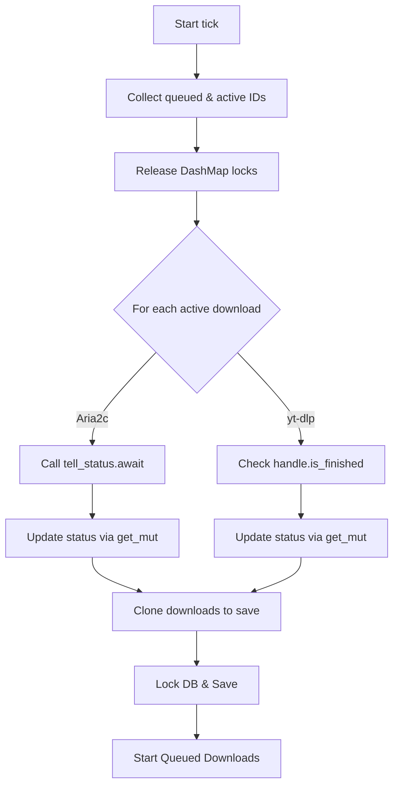

# JADMan Codebase Review and Stabilization Report

This document reports the analysis and fixes applied to the JADMan project.

## Summary of Completed Fixes

### 1. Flagship Version Deadlock Resolution
- **Issue**: The primary source of instability (deadlocks/freezes) was in `QueueManager::tick()` in [manager.rs](file:///home/test/Projects/jadman/crates/jadm-daemon/src/queue/manager.rs). When calling `.await` inside the DashMap iteration loop (`iter_mut()`), shard locks were held across async yield boundaries. Furthermore, calling `downloads.get_mut(&id)` inside the iterator body triggered self-deadlocking on the same shard.
- **Resolution**: Refactored `QueueManager::tick()` to use a **decoupled, lock-free async execution model**:
  1. **Phase 1 (Lock-free Query)**: Iterates over the queue briefly under a read lock, collecting only the IDs of queued and downloading tasks.
  2. **Phase 2 (Async Checks)**: Executes asynchronous checking (e.g. `aria2.tell_status` and handle resolution) without holding any DashMap or database locks.
  3. **Phase 3 (Quick Synchronous Writes)**: Updates individual download items with fast, isolated `get_mut` calls.
  4. **Phase 4 (Decoupled DB Persistence)**: Clones the download queue items under a quick read lock, and writes them to SQLite, ensuring the DB connection lock and DashMap locks never overlap.



### 2. Fork Version Compilation Fix (`Work/JADMan v1`)
- **Issue**: The older fork had a compilation error:
  ```
  error[E0063]: missing field `format` in initializer of `Download`
  ```
  This occurred because the `Download` struct in `JADMan v1`'s shared types included the newly introduced `format: Option<String>` field, but `Download { ... }` instantiation in `manager.rs` on line 71 did not specify the field.
- **Resolution**: Modified the `Download` initialization inside `crates/jadm-daemon/src/queue/manager.rs` to include `format: params.format.clone()`.

---

## Current Status
- **`jadman`**: compiles successfully (`cargo check` passes). The DashMap deadlock is resolved, making background polling and concurrent client queries fully stable.
